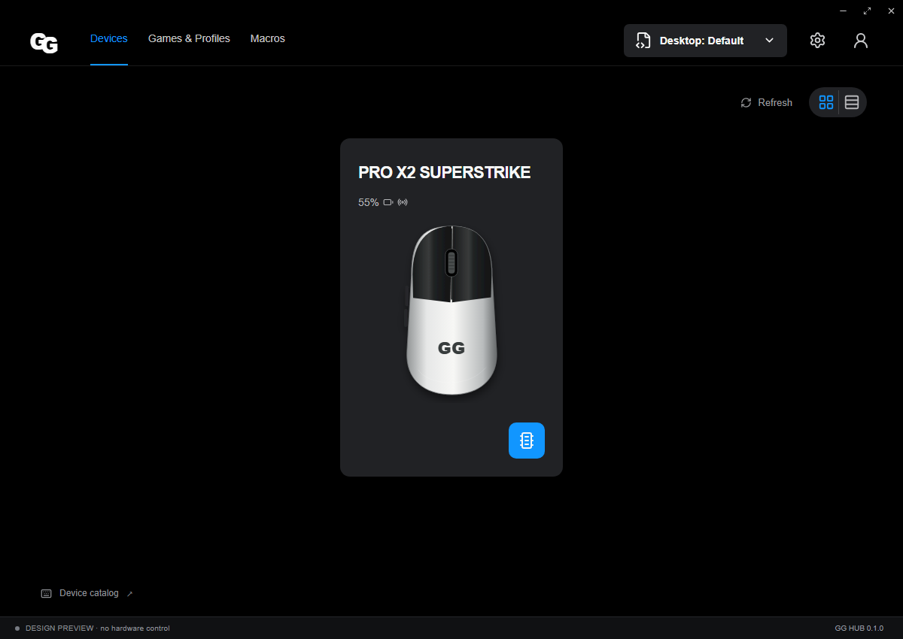

# GG HUB

GG HUB 是面向 Linux 的罗技鼠标、键盘配置工具，参考 G HUB 的页面结构，使用独立实现与素材。当前重点是驱动实际支持的 DPI、回报率、按键、灯光、板载配置、键盘选项及电量，并提供本地配置文件、宏和 X11 自动切换。**设计预览不连接硬件；目录里出现某型号也不代表 Linux 已支持。** 安装方法见下文；目前没有实物验证结果，也不保证所有型号或原版全部功能。

An independent Linux desktop configurator for Logitech gaming mice and keyboards. Electron and React provide the interface; a local Python worker talks to **ratbagd** and the **Solaar CLI**. Controls come from the connected device's driver capabilities, rather than a list of marketing specifications.



[Sensitivity view](docs/screenshots/sensitivity.png) · [Macro editor](docs/screenshots/macro-editor.png). Screenshots show design-preview mode, not a hardware compatibility result.

## Status and scope

This is an early implementation. Automated tests can exercise UI, validation, persistence, and driver protocol handling; **they do not establish physical device compatibility**. Arch Linux is the primary packaging target. No Linux hardware has been physically validated for this release.

| Area | Implementation scope |
| --- | --- |
| Mice via ratbagd | Driver-exposed DPI resolutions, polling rates, button actions, basic LED controls, and onboard profile selection |
| HID++ via Solaar | Successfully queried allowlisted controls, including supported DPI/report rates, keyboard backlight, Fn swap and G-key diversion; options depend on device and Solaar version |
| Battery | Display a real reading when the backend provides one; otherwise leave it unknown |
| Local profiles | Save, import/export, activate, and apply desired settings; local saving is distinct from hardware application |
| Macros | Bounded Linux uinput playback and stop; device-side macros depend on the driver's supported actions |
| Automatic switching | X11 foreground application matching through `xprop`; Wayland automatic switching is unsupported |

G-key diversion alone is not a complete G-key event-to-macro binding system. A driver readback confirms the driver's reported state, not a measurement of physical sensor behavior or persistence after power loss.

Firmware updates, complete per-key RGB animation, Lua compatibility, cloud/community accounts, and full G HUB feature parity are outside this release. See [the feature matrix](docs/parity.md) and [static investigation notes](docs/reverse-engineering.md).

## Installation

### Arch Linux: build a native package

The supplied `PKGBUILD` consumes a **local source snapshot**, builds the pinned Electron bundle, and installs it under `/usr/lib/gg-hub`. It does not use a system Electron package. Run these commands in a committed checkout:

```sh
sudo pacman -S --needed base-devel nodejs npm
git archive --format=tar --prefix=gg-hub-0.1.0/ HEAD | gzip -n > packaging/arch/gg-hub-0.1.0.tar.gz
cd packaging/arch
makepkg -si
```

The archive captures committed files only. The local snapshot checksum is intentionally `SKIP`; to pin your own archive, replace it with its `sha256sum` before building. `npm ci` and electron-builder download locked dependencies and Electron, so the first build **requires network access**. This PKGBUILD has not yet been executed on Arch.

Install the device backends you need:

```sh
sudo pacman -S --needed libratbag solaar python-evdev xorg-xprop
gg-hub
```

`libratbag` supplies ratbagd and its device rules; Solaar supplies its HID++ support and rules. Their actual device and permission support still applies. ratbagd normally activates over system D-Bus. If the UI reports it unavailable, check `systemctl status ratbagd.service` and the installed driver's device support. Reconnect a receiver after installing its udev rules.

Package names were checked against the official Arch package pages: [python-dbus-next](https://archlinux.org/packages/extra/any/python-dbus-next/), [python-evdev](https://archlinux.org/packages/extra/x86_64/python-evdev/), [libratbag](https://archlinux.org/packages/extra/x86_64/libratbag/), [Solaar](https://archlinux.org/packages/extra/any/solaar/).

### AppImage or tar archive

When a tagged release build succeeds, its release assets contain an AppImage, a Linux tar archive, and `SHA256SUMS`. Verify the downloaded assets against that file, then launch the AppImage:

```sh
sha256sum -c SHA256SUMS
chmod +x GG-HUB-0.1.0-x64.AppImage
./GG-HUB-0.1.0-x64.AppImage
```

The tar archive contains a `gg-hub` executable and its adjacent resources; keep them together. Both formats bundle Electron and the Python worker **source**, but require a host `python3` with `dbus-next` and, for macros, `evdev`. They also require the appropriate ratbagd/Solaar backend. On Arch, install `python python-dbus-next` plus the optional backend packages above. AppImage may require Arch's `fuse2`; `--appimage-extract` is available when a FUSE mount is unavailable.

Do not launch GG HUB as root. `GG_HUB_PYTHON=/path/to/python3` selects a Python interpreter, for example one in a virtual environment with the backend requirements installed.

### Optional macro permissions

Macros require `python-evdev`, a loaded uinput module, and permission to open `/dev/uinput`. The native package places an **inactive copy** of the rule in `/usr/share/gg-hub/70-gg-hub-uinput.rules`; enabling it is a separate choice:

```sh
sudo install -Dm644 /usr/share/gg-hub/70-gg-hub-uinput.rules /etc/udev/rules.d/70-gg-hub-uinput.rules
sudo modprobe uinput
sudo udevadm control --reload-rules
sudo udevadm trigger --subsystem-match=misc --sysname-match=uinput
```

For a source/AppImage checkout, use `packaging/70-gg-hub-uinput.rules` as the `install` source instead. Re-login if the active local session has not received access. The rule grants access through `uaccess` for the active local user; it does not make uinput world writable or grant access to all input devices. No installation script automatically loads modules or runs sudo.

## Development and design preview

Use Node.js 22 and Python 3.10 or later. On Linux, install the backend requirements in a virtual environment if not using distribution packages:

```sh
npm ci
python3 -m venv .venv
.venv/bin/python -m pip install -r backend/requirements.txt
npm run build
GG_HUB_PYTHON="$PWD/.venv/bin/python" npm start
```

For a browser-only design preview, run `npm run dev` and open its local URL. For an Electron design preview, run `npm run build` followed by `npm run preview:desktop`. Preview uses sample values and local preview storage; it does not discover or configure physical devices or execute macros. Normal `npm start` uses the real Linux backend, and does not substitute a preview device when no supported hardware is found.

Build distributable Linux files on Linux:

```sh
npm run dist:linux
```

Output goes to `release/`. The native Arch recipe uses electron-builder's unpacked directory target instead. Neither route embeds a Python interpreter or third-party Python modules.

## Verification

```sh
npm run build
npm test
python3 -m pip install -r backend/requirements.txt
PYTHONPATH=backend dbus-run-session -- bash -c 'export DBUS_SYSTEM_BUS_ADDRESS="$DBUS_SESSION_BUS_ADDRESS"; python3 -m unittest discover -s backend/tests -v'
npx playwright install --with-deps chromium
npm run test:ui
```

The isolated D-Bus test session runs a test fixture, not a real ratbagd or a physical device. UI tests run against design preview. GitHub Actions runs these checks on Ubuntu 24.04; a `v*` tag additionally builds Linux artifacts and publishes them only after that workflow's checks pass. CI and hardware validation remain separate.

## Device catalog and provenance

`data/device-catalog.json` contains factual declarations extracted from readable G HUB installation manifests: 42 parent mouse/keyboard models and their declared variants. The source index has 77 references; 69 files are opaque and one is missing. The catalog is explicitly incomplete. `catalogKnown` means a declaration was readable; it does not mean a device is connected or Linux supported. The application uses live driver capabilities for controls.

To reproduce the catalog from your own installation resources:

```sh
node tools/extract-catalog.cjs --source /path/to/core/data --output data/device-catalog.json --source-version 2026.6.981214 --build-id 876190
```

No original G HUB JavaScript, CSS, artwork, fonts, asset keys, or user configuration is distributed. The interface and illustration assets are independently implemented. Logitech and G HUB names identify interoperability targets; this project is not affiliated with Logitech.

## License and upstream projects

GG HUB's original code is [MIT licensed](LICENSE). Electron, React, and other dependencies retain their own licenses. ratbagd and Solaar are separately installed upstream programs, not copied into this source tree. See [libratbag](https://github.com/libratbag/libratbag), [Solaar device support](https://pwr-solaar.github.io/Solaar/devices/), and [Solaar features](https://pwr-solaar.github.io/Solaar/features/) when checking a particular model.
